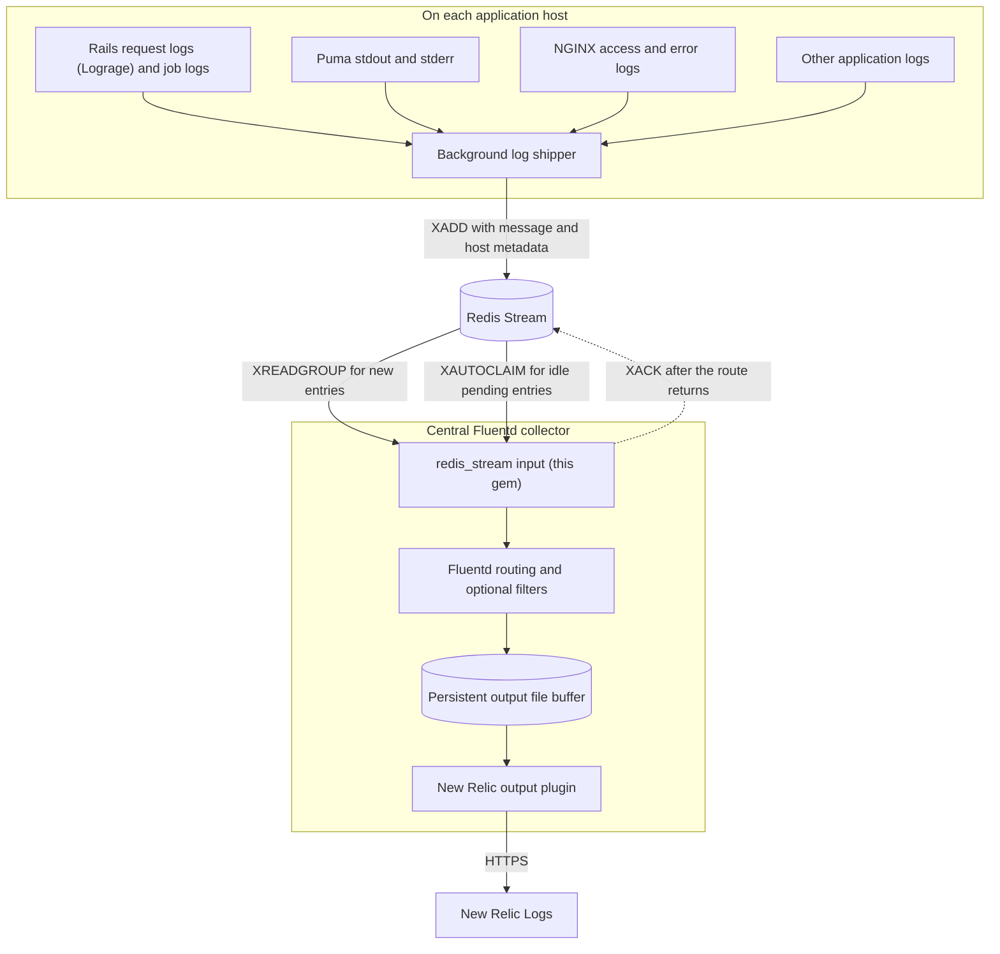

# fluent-plugin-redis-stream

[](https://github.com/mpakus/fluentd-redis-stream/actions/workflows/rspec.yml)

A Ruby input plugin for Fluentd that reads log records from a Redis Stream. It lets many application hosts feed one collector. The collector can parse, filter and forward their logs using ordinary Fluentd configuration. Install this gem on the collector. Each host needs a separate shipper that can append records to Redis.

## How a log reaches New Relic



For example, a shipper can send an NGINX access line as `message` with `hostname=web-03` and `source=nginx-access`. The plugin preserves these fields, adds the Redis stream name and entry ID, and emits the record under the configured Fluentd tag. Lograge JSON can travel in the same stream. Configure a Fluentd parser when you need to filter on fields inside that JSON.

**Delivery boundary.** Redis acknowledges a batch when the input issues `XACK` after the Fluentd route returns. A buffered output sends to New Relic later. A collector crash between buffering and acknowledgement can replay an entry. Use the pair `redis_stream` and `redis_entry_id` to identify copies.

## Try it locally

Use Ruby 3.3 or later, Fluentd 1.20.x and Redis 6.2 or later. From the checkout, build the gem and install it into the Ruby environment that runs Fluentd. The commands use the project's `rtk proxy` wrapper.

```sh
rtk proxy gem build fluent-plugin-redis-stream.gemspec
rtk proxy fluent-gem install ./fluent-plugin-redis-stream-0.1.0.gem
rtk proxy redis-cli XGROUP CREATE logs:demo fluentd 0-0 MKSTREAM
```

Create the group once. Save the following as `demo.conf` and start the collector with `rtk proxy fluentd -c demo.conf`. This local example prints each event to the terminal.

```conf
<source>
  @type redis_stream
  redis_url redis://127.0.0.1:6379/0
  stream logs:demo
  group fluentd
  consumer demo-collector
  tag demo.logs
</source>

<match demo.logs>
  @type stdout
</match>
```

In another terminal, publish one record. Compare the ID returned by Redis with `redis_entry_id` in Fluentd's output.

```sh
rtk proxy redis-cli XADD logs:demo '*' message 'Inventory sync finished' hostname web-03 source rails
```

## Run the specs

Use a POSIX environment with a running test Redis. Each RSpec example starts real Fluentd worker processes, creates its own UUID-named Redis key and uses a temporary directory for its file buffer and output. Cleanup removes that key and directory.

```sh
rtk proxy bundle install
rtk proxy bundle exec rspec
```

The default Redis URL is `redis://127.0.0.1:6379/0`. Set `TEST_REDIS_URL` to test a different instance. The suite uses Redis Streams, `XINFO GROUPS`, `XPENDING`, and permission to create and delete its own test stream.

## Documentation

- [Architecture and delivery contract](docs/architecture.md) explains the record format, event time, pending entries and replay.
- [Collector operations](docs/operations.md) lists every input parameter and shows a file-buffered New Relic configuration, monitoring and cutover.
- [Implementation and verification](docs/implementation.md) describes the read loop, the crash tests and the results of the staging delivery check.

## Author

Renat "MpaK" Ibragimov

[Made in Austin ✩ Texas](https://aomega.co/)
